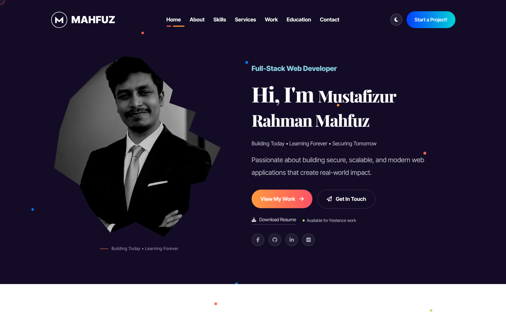
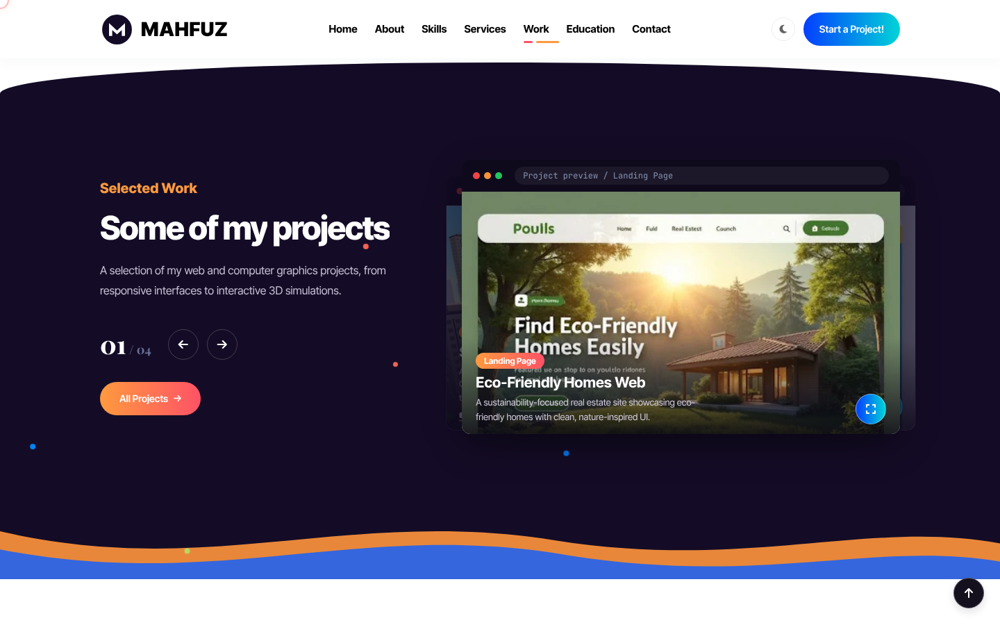
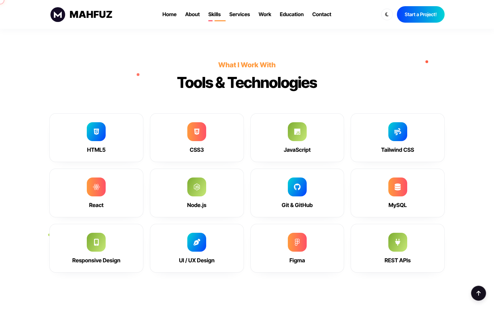
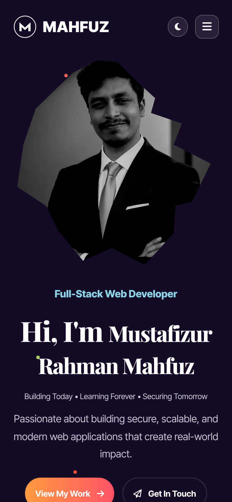

# Mustafizur Rahman Mahfuz | Portfolio

Personal portfolio website of **Mustafizur Rahman Mahfuz**, a Full-Stack Web Developer.

**Live site:** https://itsmahfuz.site

## Screenshots



| Projects | Skills |
|---|---|
|  |  |



## Sections

Home, About, Skills, Services, Process, Work (project showcase), Education and Contact.

## Tech

- HTML, Tailwind CSS and vanilla JavaScript (`assets/portfolio.js`)
- Smooth scrolling with Lenis, icons from Font Awesome
- Fully responsive layout with light and dark theme toggle

## SEO and PWA files

`sitemap.xml`, `robots.txt`, `site.webmanifest`, favicons and social preview image (`assets/mahfuz-social.jpg`).

## Run locally

It is a static site, so no build step is needed. Open `index.html` in a browser, or run a local server:

```bash
python3 -m http.server 8000
```

Then visit http://localhost:8000

## Contact

- GitHub: https://github.com/mahfuz10-max
- LinkedIn: https://www.linkedin.com/in/mustafizur-rahman-mahfuz-14b2162a3/
